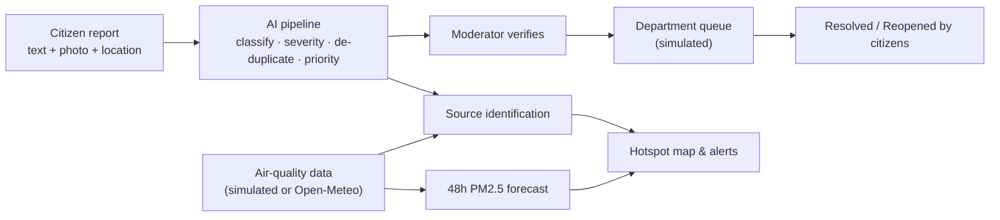

# 🌫️ AirWatch: Community-Driven Air Quality Action Platform

> **Make pollution visible, make complaints actionable, make resolution measurable.**

**Hackathon:** Neural Storm 2026 · **Track:** 2, Green Planet · **Problem statement:** **GP-01 – Air Quality Monitoring & Source Attribution** (extended: citizen reporting, accountability and forecasting)

---

## 📌 Problem

Delhi NCR residents can *see* that the air is bad, but most air-quality apps stop there. Citizens have no easy way to report a specific source (a burning garbage heap, a dusty construction site, a smoking factory), to see whether anyone else has reported it, or to find out whether authorities actually acted. Authorities, in turn, receive duplicate, unprioritised complaints with no way to tell which incident is urgent.

## 💡 Our solution

AirWatch connects **citizens → AI → authorities** in one loop, and adds air-quality intelligence on top:

| Feature | What it does |
|---|---|
| 📝 **Citizen reporting** | Report pollution in **English, Hinglish or Hindi** with location (map click), optional photo and duration. |
| 🤖 **AI complaint intelligence** | Classifies the pollution type and severity, merges duplicate reports into one **incident**, checks distance to **schools/hospitals**, and computes an **explainable 0–100 priority score**. |
| 📡 **Live community feed** | One card per verified incident, showing **report count and unique citizens separately** so duplicates can't inflate public pressure. Citizens can back an incident ("I see this too"). |
| 🏛️ **Accountability workflow** | Moderator verification → routing to a (simulated) department → acknowledge → action → resolved. Citizens can **reopen** a fix that didn't work. Full audit trail and a public **scoreboard**. |
| 📈 **48-hour PM2.5 forecast** | ML forecast per area with a calibrated 80% uncertainty band, threshold alerts, weather panel and "what drives the forecast". |
| 🗺️ **Hotspot map** | PM2.5 bubbles (now / +24 h / +48 h), heat layer and citizen incidents; ranks areas where pollution is **repeatedly** elevated ("inspect first"). |
| 🏭 **Source identification** | Estimates which sources (waste burning, construction dust, industry, traffic, crop residue burning) likely contribute in each area, with the evidence shown, plus emission-style density maps. |

## 🧭 How it works



**Priority score** (transparent weighted formula; every factor is shown to the user): severity 30% · proximity to school/hospital 20% · unique citizens affected 15% · pollution-type risk 15% · duration 10% · population density 10%.

---

## 🛠️ Tech stack

| Layer | Technology |
|---|---|
| Language | **Python 3.10–3.12** (all AI/ML components) |
| ML | scikit-learn (TF-IDF + logistic regression, HistGradientBoosting, DBSCAN), NumPy, pandas |
| Frontend | **Streamlit**, Altair, Folium (OpenStreetMap), Matplotlib |
| Backend / API | SQLAlchemy + SQLite, FastAPI (optional REST API sharing the same service layer) |
| Data | Synthetic complaints (generated), simulated air quality **or** real hourly data from [Open-Meteo](https://open-meteo.com) |
| Testing | pytest + Streamlit AppTest (35 tests) |
| Deployment | Streamlit Community Cloud |

## 📁 Project structure

```
Airwatch/
├── streamlit_app.py            # Home page (Streamlit entry point)
├── pages/                      # 1 Report · 2 Feed · 3 Authority Portal · 4 Scoreboard
│                               # 5 Model Performance · 6 Forecast · 7 Hotspot Map · 8 Pollution Sources
├── frontend/common.py          # Shared UI helpers (cards, maps, sign-in)
├── app/
│   ├── main.py, routes/        # Optional FastAPI REST API
│   ├── models.py, database.py, schemas.py, crud.py, config.py
│   └── services/               # classifier, dedupe, priority, lifecycle, pipeline, actions,
│                               # aq_data, aq_sim, forecast, aq_hotspots, sources, demo ...
├── ml/                         # generate_data.py, train.py, train_forecast.py, artifacts/ (models + metrics)
├── scripts/                    # seed_demo.py, fetch_open_meteo.py
├── data/                       # complaints.csv, places.csv (synthetic)
└── tests/
```

---

## 🚀 Setup & run locally

**Requirements:** Python 3.10–3.12 and Git.

```bash
git clone https://github.com/[YOUR-USERNAME]/Airwatch.git
cd Airwatch

# 1. Virtual environment
python -m venv .venv
.venv\Scripts\activate            # Windows (PowerShell: .venv\Scripts\Activate.ps1)
# source .venv/bin/activate       # macOS / Linux

# 2. Install
pip install -r requirements.txt

# 3. Train the models (about 1 minute in total)
python -m ml.generate_data        # synthetic complaint dataset
python -m ml.train                # category / severity / duplicate-detection models
python -m ml.train_forecast       # PM2.5 forecaster

# 4. (Optional) run the tests: expect 35 passed
python -m pytest -q

# 5. Run the app
streamlit run streamlit_app.py    # opens http://localhost:8501
```

On first launch the app loads demo data (15 reports across 10 incidents). Use **Quick demo login** in the sidebar.
If the model files are missing or incompatible, the app **trains them automatically** on startup.

<details>
<summary><b>Optional: use real air-quality data (Open-Meteo)</b></summary>

```bash
python -m scripts.fetch_open_meteo   # free, no API key → data/air_quality.csv
python -m ml.train_forecast          # retrain on the real data
```
The app switches from the simulation to real data automatically. Open-Meteo air quality is **CAMS atmospheric-model output, not ground-monitor readings**.
</details>

<details>
<summary><b>Optional: run the REST API</b></summary>

```bash
uvicorn app.main:app --reload        # Swagger docs at http://127.0.0.1:8000/docs
```
Key endpoints: `POST /complaints`, `GET /feed`, `GET /hotspots`, `POST /complaints/{id}/support`, `PATCH /complaints/{id}/status`, `POST /complaints/{id}/reopen`, `GET /departments/{id}/queue`, `GET /stats`.
</details>

**Reset demo data:** stop the app and delete `airwatch.db` and the `uploads/` folder.

---

## 🖼️ Screenshots

> [ADD SCREENSHOTS in `docs/screenshots/` and keep these lines. Suggested: report result card, feed, hotspot map, forecast, sources, authority portal.]

| Report + AI analysis | Community feed |
|---|---|
|  |  |

| Hotspot map | 48-hour forecast |
|---|---|
|  |  |

| Source identification | Authority portal |
|---|---|
|  |  |

---

## 📊 Model performance

> ⚠️ **All numbers below are on SYNTHETIC / SIMULATED data.** They show that the pipelines work end to end, **not** real-world accuracy. Full details are in `ml/artifacts/metrics.json` and `ml/artifacts/forecast_metrics.json`, and on the app's **Model Performance** page.

### Complaint intelligence (synthetic dataset: 1,435 complaints, split by incident so none appears in both train and test)

| Task | Metric | Result |
|---|---|---|
| Pollution-type classifier (5 classes, EN/Hinglish/Hindi) | Macro-F1 | **0.917** (word-TF-IDF baseline 0.904) |
| | Accuracy | 0.923 |
| | Macro-F1 by language | English 0.919 · Hinglish 0.906 · Hindi 0.941 |
| Severity classifier (4 levels) | Macro-F1 | **0.707** (text only 0.690) |
| | Mean error | 0.38 severity levels |
| Duplicate detection (same incident = same category within radius) | Precision / Recall / F1 | 0.994 / 0.836 / **0.908** |
| Hotspot clustering | Adjusted Rand Index | **0.905** (105 true incidents → 125 predicted) |

### PM2.5 forecast (48 h ahead, simulated data, time-based train/calibration/test split)

| Metric | AirWatch model | "No change" baseline |
|---|---|---|
| RMSE (µg/m³) | **34.1** | 63.5 |
| MAE (µg/m³) | **26.2** | n/a |
| Bias (µg/m³) | +5.1 | n/a |
| 80% interval coverage | 78.6% (target 80%) | n/a |

*These figures are from one training run. The simulation is seeded by date, so exact values vary slightly; re-run `python -m ml.train_forecast` and copy the current values from `ml/artifacts/forecast_metrics.json`.* At 1 hour ahead the model is roughly tied with the no-change baseline; its advantage grows with the horizon.

### Methods in brief
- **Classifiers:** word + character n-gram TF-IDF (handles Hinglish spelling variants and typos) with logistic regression. Severity also uses distance to the nearest school/hospital and duration.
- **Forecaster:** one gradient-boosting model across all areas and horizons; predicts the log-change versus persistence, using lagged PM2.5, weather at the target hour and area type. Quantile models give the uncertainty band, **widened on a held-out calibration period** so coverage is honest.
- **Source identification:** transparent evidence fusion of (1) nearby citizen reports 45%, (2) sensor signatures such as PM10/PM2.5 ratio, NO₂ and diurnal patterns 30%, (3) land-use prior 25%.

---

## ⚠️ Limitations & honest disclosures

- **Data:** complaints are synthetic. Air quality is simulated unless you run the Open-Meteo fetch (CAMS model estimates, not ground monitors). Satellite fire data (NASA FIRMS) and CPCB monitor feeds are **not** connected.
- **Source identification is indicative**, not a validated source-apportionment study. Shares are normalised scores, not measured emissions. The density maps show *complaint* density.
- **Government integration is simulated.** Departments, routing and the portal are a demo; real routing needs verified contacts or an official partnership.
- **No real authentication.** Sign-in is simulated (no passwords).
- **AI is advisory.** Scores are illustrative, not validated risk measurements, and human verification is required before an incident is published.
- Photos are stored but **not analysed**; the SQLite database and uploads reset when the hosted app restarts.
- PM2.5 category bands follow CPCB AQI breakpoints, which are defined for 24-hour averages; they are applied to hourly values here as an approximation.

## 🔒 Privacy & responsible use
Public views never show citizen identities; scoreboards report on departments and localities, not named officers. Users are reminded not to photograph faces or number plates. Reports are verified before publication, and each citizen counts once per incident to limit brigading.

## 🗺️ Future work
Real ground-monitor and satellite fire feeds · photo/video analysis · GPS capture · real authentication and role-based access · direct department integrations · multilingual voice reporting · before/after resolution evidence.

---

## 🤖 AI development tools disclosure

In line with the Neural Storm 2026 rules, we disclose the AI tools used:

- **Claude (Anthropic):** used extensively as a coding and design assistant: architecture, Python code for the data pipeline, models, FastAPI/Streamlit app and tests, and debugging.
- **ChatGPT (OpenAI):** used for early brainstorming and refinement of the project concept and feature descriptions.

We reviewed, ran and tested the generated code ourselves. 
